# Home Assistant Integration Guide

Green'up Link features built-in, native **Home Assistant MQTT Auto-Discovery**. Once enabled, your Legrand Green'up charging station automatically appears in Home Assistant as a first-class device with all its controls, telemetry sensors, binary state sensors, and diagnostic entities.

Zero custom components, zero HACS repositories, and zero manual YAML sensor definitions are needed!

---

## 1. Prerequisites & Green'up Link Configuration

Before Home Assistant can discover your charging station, make sure:
1. You have an active MQTT broker running (such as the official **Home Assistant Mosquitto broker** add-on or a standalone Mosquitto instance).
2. The **MQTT Integration** is installed and configured in Home Assistant (**Settings > Devices & Services > MQTT**).
3. The MQTT client and auto-discovery are enabled in your `greenup.toml` configuration file.

### Configuring `greenup.toml`

Open your `greenup.toml` file (located on the Raspberry Pi hosting Green'up Link) and ensure the `[mqtt]` section is configured:

```toml
[http]
# If you set an API token, it will automatically serve as the MQTT password!
api_token = "my_secure_api_token"

[mqtt]
# Enable the autonomous MQTT client
enabled = true

# Address and port of your MQTT broker (e.g. Home Assistant IP)
broker = "192.168.1.100:1883"

# Optional MQTT username (defaults to "greenup-link" if empty)
username = "homeassistant"

# Base MQTT topic prefix
base_topic = "greenup"

# Enable Home Assistant MQTT Auto-Discovery (Default: true)
ha_discovery = true
```

> 💡 For comprehensive details on MQTT topics, authentication models, retain flags, and remote control commands, refer to the [Green'up Link MQTT Integration Guide](GREENUP_LINK_MQTT.md).

Restart the Green'up Link service:
```bash
sudo systemctl restart greenup-link
```

---

## 2. Verifying Auto-Discovery in Home Assistant UI

When Green'up Link starts with `ha_discovery = true`, it queries the ATmega power board, identifies the station hardware model and firmware version, and immediately publishes discovery payloads to the standard `homeassistant/.../config` topics.

Follow these steps to view and inspect your station in Home Assistant:

1. Open your **Home Assistant** web interface.
2. In the left sidebar, navigate to **Settings** (`Paramètres`) > **Devices & Services** (`Appareils et services`).
3. Click on the **MQTT** integration tile.
4. Click on the **Devices** (`Appareils`) tab at the top.
5. In the device list, locate **`Legrand Green'up (<model>)`** (for example, `Legrand Green'up (058001)`).
6. Click on the device to open the comprehensive device dashboard.

---

## 3. Discovered Device Entities & Controls

Home Assistant automatically organizes all entities into logical cards on the device page:

```mermaid
graph TD
    Device["Legrand Green'up Station"]
    Device --> Controls["Controls & Actuators"]
    Device --> Sensors["Electrical Telemetry"]
    Device --> States["Binary Status"]
    Device --> Diagnostics["Diagnostic & System"]

    Controls --> C1["Charge Switch (ON / OFF)"]
    Controls --> C2["Pause Switch (ON / OFF)"]
    Controls --> C3["Current Setpoint Slider (7A – 32A)"]

    Sensors --> S1["Active Power (W)"]
    Sensors --> S2["Cumulative Energy (kWh)"]
    Sensors --> S3["Real-time Current (A)"]
    Sensors --> S4["Effective Voltage (V)"]
    Sensors --> S5["IEC State (A, B, C, E, F)"]
    Sensors --> S6["OCPP Status (Available, Charging...)"]

    States --> B1["Vehicle Connected (Plug)"]
    States --> B2["Charging Active (Battery)"]
    States --> B3["Session Active"]

    Diagnostics --> D1["USB Link Status"]
    Diagnostics --> D2["Firmware Version"]
    Diagnostics --> D3["Hardware Serial Number"]
```



### 3.1 Controls (Actuators)
- **`Charge`** (`switch.legrand_greenup_charge`): Master charge authorization.
  - `ON`: Authorizes charging.
  - `OFF`: Shuts down contactor and disables charging.
- **`Pause`** (`switch.legrand_greenup_pause`): Software pause button. Temporarily suspends charging without dropping the pilot connection.
- **`Current Setpoint`** (`number.legrand_greenup_current_setpoint`): Interactive slider allowing real-time current regulation from **7A to 32A** (1A steps). Dynamically modifies the internal Legrand `CCEl` register.

### 3.2 Electrical Telemetry Sensors
- **`Power`** (`sensor.legrand_greenup_power`): Real-time active charging power in Watts (**W**). Uses `device_class: power`.
- **`Total Energy`** (`sensor.legrand_greenup_total_energy`): Cumulative lifetime energy delivered in kilowatt-hours (**kWh**). Configured with `state_class: total_increasing` and `device_class: energy`, making it instantly compatible with the **Home Assistant Energy Dashboard**.
- **`Current`** (`sensor.legrand_greenup_current`): Actual measured current delivered to the electric vehicle in Amperes (**A**).
- **`Voltage`** (`sensor.legrand_greenup_voltage`): Grid voltage in Volts (**V**). Reflects nominal 230.0V or dynamically injected external voltage.

### 3.3 State & Status Sensors
- **`IEC State`** (`sensor.legrand_greenup_iec_state`): Standard IEC 61851-1 operational state:
  - `A`: Standby / Available (no vehicle connected).
  - `B`: Vehicle connected (waiting for authorization or vehicle request).
  - `C`: Active charging (contactor closed, power delivered).
  - `E` / `F`: Fault / Error state.
- **`OCPP Status`** (`sensor.legrand_greenup_ocpp_status`): Standardized status (`Available`, `Preparing`, `Charging`, `SuspendedEVSE`, `SuspendedEV`, `Faulted`).
- **`Applied Limit`** (`sensor.legrand_greenup_applied_limit`): Current limit currently enforced by the ATmega controller (`CC` in amperes).

### 3.4 Binary Sensors
- **`Vehicle Connected`** (`binary_sensor.legrand_greenup_vehicle_connected`): `on` when the charging cable is securely plugged into both the car and the socket.
- **`Charging`** (`binary_sensor.legrand_greenup_charging`): `on` when active current is flowing into the vehicle.
- **`Session Active`** (`binary_sensor.legrand_greenup_session_active`): `on` throughout an ongoing plug-in session.

### 3.5 Diagnostic & Station Level
- **`Station Total Power`** (`sensor.legrand_greenup_station_total_power`): Total combined power across all connectors (useful for dual-socket models).
- **`Grid Voltage Injection`** (`number.legrand_greenup_grid_voltage_injection`): Input slider (100V–300V) allowing manual or automated grid voltage updates.
- **`USB Serial Status`** (`sensor.legrand_greenup_serial_status`): Health of the USB link between the Raspberry Pi and the ATmega board (`usb_connected`, `usb_disconnected`, etc.).

---

## 4. Adding to the Home Assistant Energy Dashboard

The cumulative energy sensor provided by Green'up Link complies with Home Assistant's long-term statistics standards (`state_class: total_increasing`, `unit_of_measurement: kWh`, `device_class: energy`).

To add your Legrand Green'up wallbox to your Energy dashboard:

1. In Home Assistant, go to **Settings** > **Dashboards** > **Energy**.
2. Scroll down to the **Individual devices** section.
3. Click **Add Device**.
4. In the dropdown, select **`Legrand Green'up Total Energy`** (`sensor.legrand_greenup_total_energy`).
5. Click **Save**.

Your EV charging consumption will now be tracked alongside your solar generation, home grid consumption, and battery storage.

---

## 5. Automation: Dynamic Grid Voltage Synchronization

### Why Inject Grid Voltage?

The Legrand ATmega power board has built-in current transformers measuring exact current ($I$), but lacks a precision voltmeter. By default, Green'up Link uses nominal single-phase voltage ($230.0\text{ V}$) to calculate instantaneous active power ($P = U \times I$) and delivered energy.

If you have an external sensor measuring real-time mains voltage in Home Assistant (such as an Enedis Linky TIC meter via Denky D4 / Zigbee / ESPHome, a Shelly EM, a solar inverter, or a whole-house energy monitor), you can inject this live voltage into Green'up Link every 30 seconds.

This ensures:
- **Ultra-precise active power**: Real-time Watts match your actual grid conditions (e.g. 238V or 225V).
- **Exact energy metering**: kWh accumulation matches your official electricity meter down to the watt-hour.

---

### Step-by-Step UI Guide to Create the Automation

Choose either **Method A** (fastest via YAML mode) or **Method B** (using the visual UI builder without writing code).

#### Method A: YAML Mode via Automation Editor (Quickest)

1. In Home Assistant, navigate to **Settings** > **Automations & Scenes** > **Automations**.
2. Click the **+ Create Automation** button (in the lower right), then select **Create new automation**.
3. In the top-right corner of the editor, click the three-dots menu (`⋮`) and select **Edit in YAML**.
4. Replace the default template with the following configuration:

```yaml
alias: "Green'up - Synchronize Grid Voltage"
description: "Injects real-time grid mains voltage into Legrand Green'up for exact power and energy calculation"
mode: single
trigger:
  - platform: time_pattern
    seconds: "/30" # Triggers every 30 seconds
condition:
  # Ensure the voltage sensor is active and valid
  - condition: template
    value_template: "{{ states('sensor.your_grid_voltage_sensor') not in ['unavailable', 'unknown', 'none', ''] }}"
action:
  - action: mqtt.publish
    data:
      topic: "greenup/station/voltage/set"
      payload: "{{ states('sensor.your_grid_voltage_sensor') | float(230.0) | round(1) }}"
```

> ⚠️ **Important:** Replace `sensor.your_grid_voltage_sensor` with the actual entity ID of your grid voltage sensor (e.g. `sensor.denky_d4_voltage`, `sensor.shelly_em_voltage`, `sensor.linky_urms1`, etc.).

5. Click **Save** in the lower right corner, give your automation a name, and confirm.

---

#### Method B: Visual UI Builder (No YAML)

If you prefer building the automation entirely through the Home Assistant graphical interface:

1. Navigate to **Settings** > **Automations & Scenes** > **Automations**.
2. Click **+ Create Automation** > **Create new automation**.

##### Step 1: Add the Trigger
1. In the **When** (Triggers) section, click **Add Trigger**.
2. Choose **Time pattern** (`Modèle horaire`).
3. In the **Seconds** (`Secondes`) field, type:
   ```text
   /30
   ```
   *(This tells Home Assistant to fire every 30 seconds: at :00 and :30).*

##### Step 2: Add the Safety Condition
1. In the **And if** (Conditions) section, click **Add Condition**.
2. Choose **Template** (`Modèle`).
3. In the **Template** text box, enter:
   ```jinja2
   {{ states('sensor.your_grid_voltage_sensor') not in ['unavailable', 'unknown', 'none', ''] }}
   ```
   *(Remember to replace `sensor.your_grid_voltage_sensor` with your sensor's entity ID).*

##### Step 3: Add the Action
1. In the **Then do** (Actions) section, click **Add Action**.
2. Select **Perform action** (`Exécuter une action`).
3. In the search box, search for **`MQTT: Publish`** (`mqtt.publish`) and select it.
4. In the **Topic** field, enter:
   ```text
   greenup/station/voltage/set
   ```
5. In the **Payload** field, enter:
   ```jinja2
   {{ states('sensor.your_grid_voltage_sensor') | float(230.0) | round(1) }}
   ```

##### Step 4: Save the Automation
1. Click the orange **Save** button in the lower right corner.
2. Enter the title: **`Green'up - Synchronize Grid Voltage`**.
3. Click **Save**.

---

### Verifying Automation Operation

Once saved, verify that the automation is actively publishing:

1. **Check Home Assistant Traces**:
   - On the automation page, click **Traces** (top right).
   - You should see successful execution steps recorded every 30 seconds.
2. **Check the Home Assistant Device Page**:
   - Open **Settings > Devices & Services > MQTT > Legrand Green'up**.
   - The **`Voltage`** sensor will now show decimal values (e.g. `234.6 V`) updating continuously.
3. **Check the Green'up Link Web GUI**:
   - Open `http://<station_ip>:8080`.
   - The **Voltage** card on the dashboard displays the injected value with the subtitle: `external source (TTL 60s)`.
4. **Check Green'up Link Logs**:
   - In the Web GUI debug console (or `/var/log/greenup-link/greenup_YYYY-MM-DD.log`), observe the confirmation:
     ```text
     [INFO] [API] ⚡ External voltage injected: 234.6V (TTL: 60s)
     ```

---

## 6. Additional Useful Automations

### 6.1 Off-Peak (Heures Creuses) Scheduled Charging

Automatically start charging at 22:00 and pause at 06:00 during off-peak electricity hours:

```yaml
alias: "Green'up - Off-Peak Charging Schedule"
description: "Automatically enables charging during off-peak hours (22:00 - 06:00)"
mode: single
trigger:
  - platform: time
    at: "22:00:00"
    id: "start_offpeak"
  - platform: time
    at: "06:00:00"
    id: "stop_offpeak"
action:
  - choose:
      - conditions:
          - condition: trigger
            id: "start_offpeak"
        sequence:
          - action: switch.turn_on
            target:
              entity_id: switch.legrand_greenup_charge
      - conditions:
          - condition: trigger
            id: "stop_offpeak"
        sequence:
          - action: switch.turn_off
            target:
              entity_id: switch.legrand_greenup_charge
```

### 6.2 Mobile Notification when Charging Completes

Receive a push notification on your smartphone when the car finishes charging:

```yaml
alias: "Green'up - Notify Charge Complete"
description: "Sends a mobile notification when the EV finishes charging"
mode: single
trigger:
  - platform: state
    entity_id: binary_sensor.legrand_greenup_charging
    from: "on"
    to: "off"
condition:
  - condition: state
    entity_id: binary_sensor.legrand_greenup_vehicle_connected
    state: "on"
action:
  - action: notify.notify
    data:
      title: "⚡ EV Charging Complete"
      message: >-
        Charging session finished!
        Energy added: {{ states('sensor.legrand_greenup_total_energy') }} kWh.
```

---

## 7. Troubleshooting & FAQ

### 1. The device does not appear in Home Assistant
- **Verify MQTT connection**: In Green'up Link startup logs, verify you see:
  ```text
  [INFO] [MQTT] ✅ Connected to MQTT broker '192.168.1.100:1883'
  ```
- **Check Auto-Discovery setting**: Ensure `ha_discovery = true` is set in `greenup.toml`.
- **Check discovery prefix**: Green'up Link publishes to `homeassistant/.../config`. Verify that your Home Assistant MQTT integration uses the standard `homeassistant` discovery prefix (**Settings > Devices & Services > MQTT > Configure**).
- **Restart Green'up Link**: Trigger a fresh discovery announcement by running:
  ```bash
  sudo systemctl restart greenup-link
  ```

### 2. Entities appear as `Unavailable`
- Green'up Link uses an MQTT Last Will and Testament (**LWT**) on `greenup/availability`.
- When Green'up Link disconnects or if the internal USB serial link between the Raspberry Pi and the ATmega board drops, entities are marked `unavailable` to prevent displaying stale data.
- Check the USB connection and Green'up Link service status:
  ```bash
  sudo systemctl status greenup-link
  ```

### 3. Current setpoint changes are not accepted below 7A
- The Legrand Green'up ATmega power board enforces an absolute hardware threshold of **7 Amperes** minimum.
- Any setpoint lower than 7A is automatically rejected by the driver to preserve hardware safety and communication integrity. To pause charging, toggle the **`Pause`** switch or disable the **`Charge`** switch rather than reducing current to zero.

### 4. Commands are ignored in Sniffer Mode
- If `sniffer_mode = true` is active in `greenup.toml`, Green'up Link operates as a passive listener only. All control topics (`.../set`) are intentionally ignored to avoid sending TX frames to the ATmega.
