# Legrand Green'Up Premium — State-Sequence Diagrams

Detailed, firmware-verified state transition diagrams derived from the ATmega power board firmware (`greenup-heart`).  
These diagrams cover the most common **home automation / EMS** scenarios (Type 2, domestic 2P+T socket, three-phase load modulation, TIC Linky load-shedding, stops/suspensions, and hardware faults).

---

## Table of Contents

1. [Type 2 (T2S) — Nominal & Smart-Charging Sequences](#1-type-2-t2s--nominal--smart-charging-sequences)
   - [1.1 Direct Charge (FM2:0) — EV Stops & Unplugs](#11-direct-charge-fm20--ev-stops--unplugs)
   - [1.2 Smart-Charging Gate (FM2:1 + DOK/DNOK)](#12-smart-charging-gate-fm21--dokdnok)
   - [1.3 Deferred Start (Dec:) & 30 s EV Wake-Up](#13-deferred-start-dec--30-s-ev-wake-up)
2. [Stops, Suspensions, Traps & Deep Sleep (T2S)](#2-stops-suspensions-traps--deep-sleep-t2s)
   - [2.1 Clean In-Session Suspension (CAUNOK / CAUOK, No TIC)](#21-clean-in-session-suspension-caunok--cauok-no-tic)
   - [2.2 Local Stop Button (SBNOK / SBOK or Short Press)](#22-local-stop-button-sbnok--sbok-or-short-press)
   - [2.3 Pitfalls: T2CNOK Lockout & Unlock Restart Loop](#23-pitfalls-t2cnok-lockout--unlock-restart-loop)
   - [2.4 Deep Sleep Mode (SOK / SNOK)](#24-deep-sleep-mode-sok--snok)
3. [Domestic Socket (2P+T / Schuko) & T2S Priority](#3-domestic-socket-2pt--schuko--t2s-priority)
   - [3.1 Domestic Direct Charge (FM2:0, No Derogation)](#31-domestic-direct-charge-fm20-no-derogation)
   - [3.2 Domestic Conditioned / Derogation (FM2:1 + DOK/DNOK)](#32-domestic-conditioned--derogation-fm21--dokdnok)
   - [3.3 Domestic Local Stop (SBNOK) & Invalidation (2PCNOK)](#33-domestic-local-stop-sbnok--invalidation-2pcnok)
   - [3.4 Absolute Type 2 Priority over Domestic Socket](#34-absolute-type-2-priority-over-domestic-socket)
4. [Three-Phase Modulation & TIC Linky Load-Shedding](#4-three-phase-modulation--tic-linky-load-shedding)
   - [4.1 Three-Phase Charge & Dynamic Current Modulation (11–22 kW)](#41-three-phase-charge--dynamic-current-modulation-1122-kw)
   - [4.2 Hardware PWM Floor Trap → Overcurrent Reboot (E:0010)](#42-hardware-pwm-floor-trap--overcurrent-reboot-e0010)
   - [4.3 TIC Linky Off-Peak (HP/HC) & Autonomous Load-Shedding](#43-tic-linky-off-peak-hphc--autonomous-load-shedding)
5. [Hardware Faults, Safety Interlocks & Power Outage](#5-hardware-faults-safety-interlocks--power-outage)
   - [5.1 Recoverable Faults (State:R) & Auto-Reboot (State:X)](#51-recoverable-faults-stater--auto-reboot-statex)
   - [5.2 Critical Latched Faults (State:S) — Shunt-Trip MX](#52-critical-latched-faults-states--shunt-trip-mx)
   - [5.3 Control Pilot Short (State:T) & Ventilation (State:N)](#53-control-pilot-short-statet--ventilation-staten)
   - [5.4 Mains Power Outage (State:U / State:V — E:0012)](#54-mains-power-outage-stateu--statev--e0012)

---

## 1. Type 2 (T2S) — Nominal & Smart-Charging Sequences

### 1.1 Direct Charge (`FM2:0`) — EV Stops & Unplugs

Plug-and-charge flow when `FM2:0` (direct mode) is active: the station automatically locks the T2S cable, starts PWM after 4.5 s, closes Contactor 1 when the EV pulls CP to 6 V, streams 1 Hz telemetry (`CPh:Mono`, `CCI:<I1>`), pauses in `State:I` if the EV stops drawing (emitting `FCS:1` after 20 min), and ends the session cleanly on unplug.

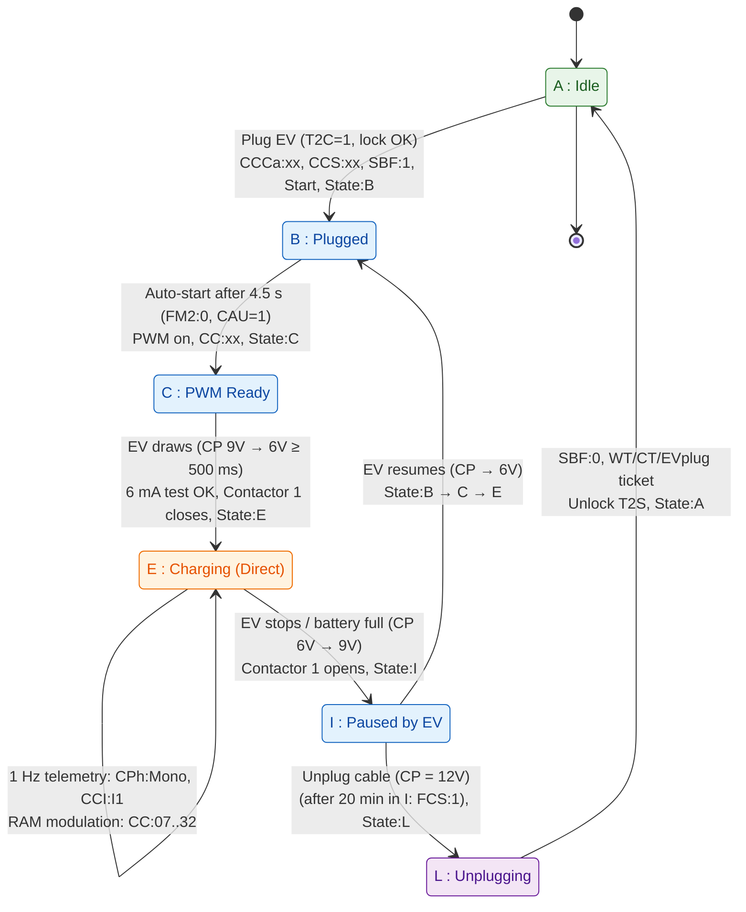

### 1.2 Smart-Charging Gate (`FM2:1` + `DOK`/`DNOK`)

Recommended solar surplus / EMS gating mode: pre-arming `FM2:1` + `DNOK` holds the EV in `State:B` with the cable locked and no PWM until the EMS sends `DOK` (or the user holds the front button). Sending `DNOK` mid-charge ramps down cleanly via `State:W` (≤ 6.1 s) without closing the session. Switching `FM2:0` ↔ `FM2:1` mid-charge transitions between `D` and `E` without dropping Contactor 1.

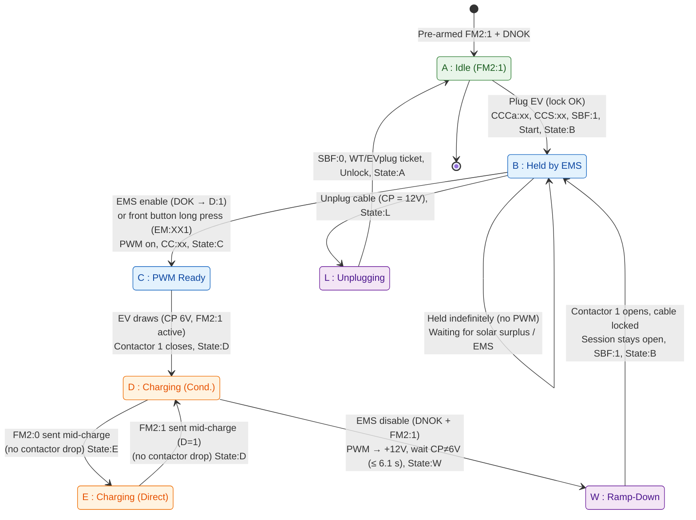

### 1.3 Deferred Start (`Dec:`) & 30 s EV Wake-Up

Deferred timer via serial `Dec:<min>` or front button (3h / 6h / 9h), plus the ATmega automatic wake-up pulse (`FUN_code_008c86`: CP 0 V for 3 s → +12 V for 0.9 s → resume PWM) when an EV stays in `State:C` or `State:I` without drawing.

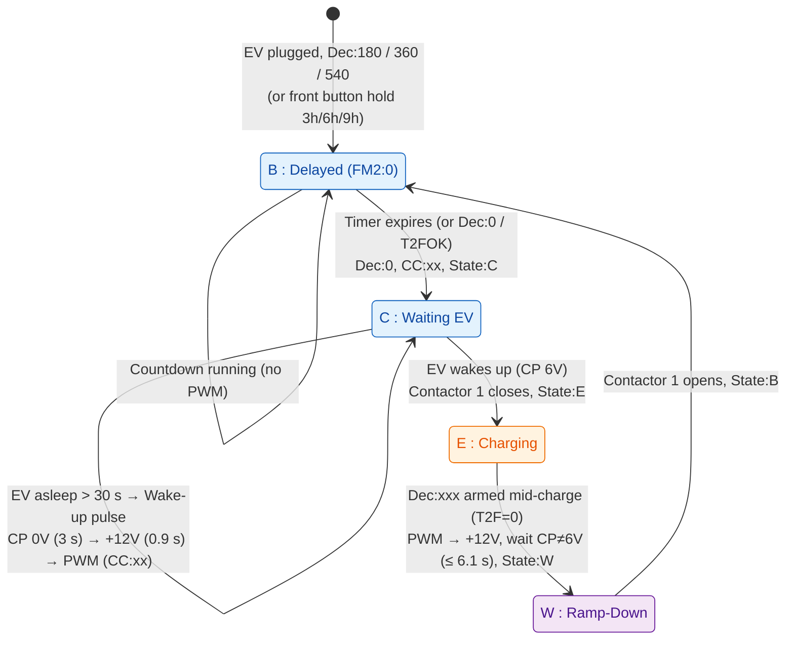

---

## 2. Stops, Suspensions, Traps & Deep Sleep (T2S)

### 2.1 Clean In-Session Suspension (`CAUNOK` / `CAUOK`, No TIC)

Temporary suspension from the EMS (`CAUNOK`) without closing the energy session (`WT`/`CT` ticket) and without EEPROM wear (unlike `FM2:` writes). If paused while the EV was already in `State:I`, the ATmega moves to `State:J` under `FM2:1` (or `State:B` under `FM2:0`).

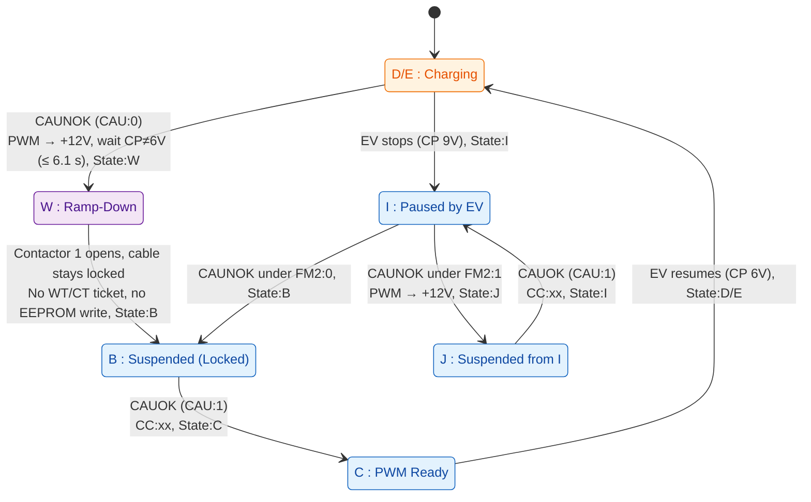

### 2.2 Local Stop Button (`SBNOK` / `SBOK` or Short Press)

Pressing the Stop button (or sending `SBNOK`) closes the active session (`WT`/`CT`/`EVplug`), unlocks the T2S cable, and enters the stable paused `State:M` until the cable is unplugged or `SBOK` / a short press re-arms the station.

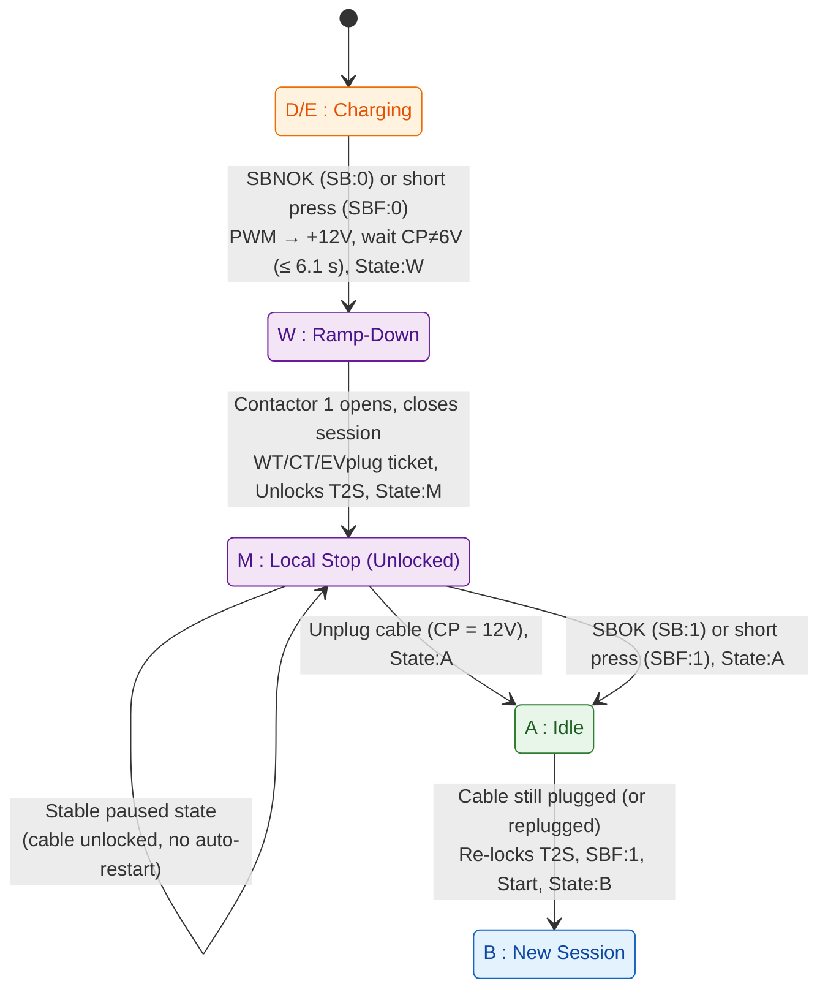

### 2.3 Pitfalls: `T2CNOK` Lockout & `Unlock` Restart Loop

Two common supervisor integration traps observed in firmware:
1. **`T2CNOK` (`T2C:0`)**: forces immediate transition through `State:M` to `State:A`, leaving the FSM blind to physical plug/unplug events until `T2COK` is sent.
2. **`Unlock`**: closes the session, unlocks the cable, and returns to `State:A` — if the cable is still plugged and `T2C=1`, the board immediately re-locks and starts a new session (`B → C → E`).

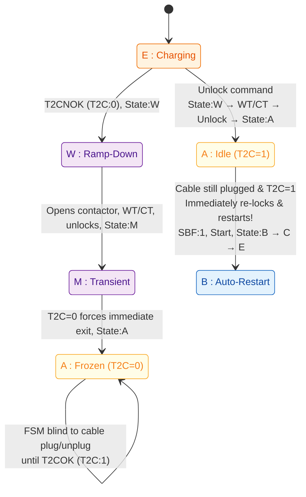

### 2.4 Deep Sleep Mode (`SOK` / `SNOK`)

Entering deep sleep (`SOK` → `Slp:1`) cleanly ramps down any active session, unlocks the T2S socket, and places the board into low-power `State:Y` (dim LED pulse every 5 s) until `SNOK` (`Slp:0`) restores `State:A`.

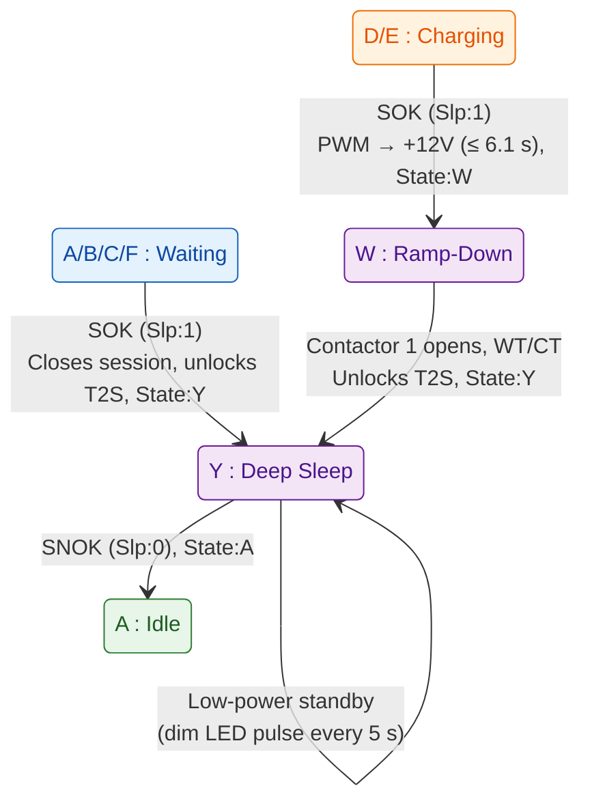

---

## 3. Domestic Socket (2P+T / Schuko) & T2S Priority

### 3.1 Domestic Direct Charge (`FM2:0`, No Derogation)

Inserting a 2P+T plug closes the mechanical detection micro-switch (`DOM=1`), entering `State:F` and automatically energizing Contactor 2 (16 A) into `State:H` after 4.5 s (provided `2PC=1` and the 6 mA DC leakage test passes).

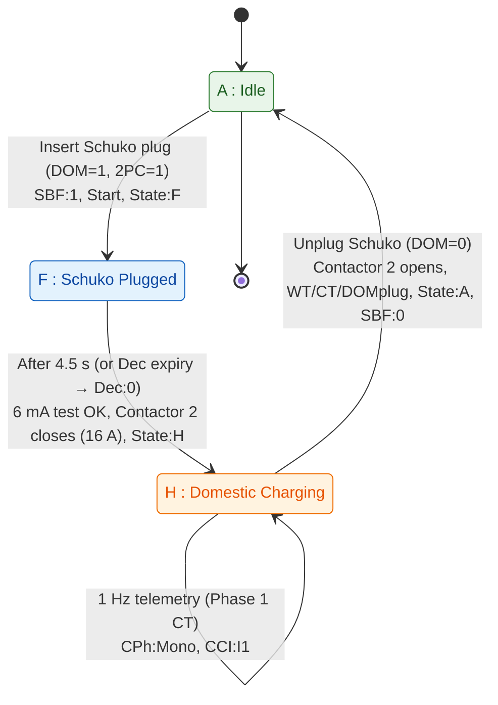

### 3.2 Domestic Conditioned / Derogation (`FM2:1` + `DOK`/`DNOK`)

Under `FM2:1` (or TIC Peak Hours), inserting a Schuko plug holds Contactor 2 open in `State:F` until authorized by EMS (`DOK`), external dry contact, or front button long press (`State:G`). Sending `2PFOK` forces an immediate transition into `State:H`, bypassing `FM2:1`, `CAU`, and `Dec`.

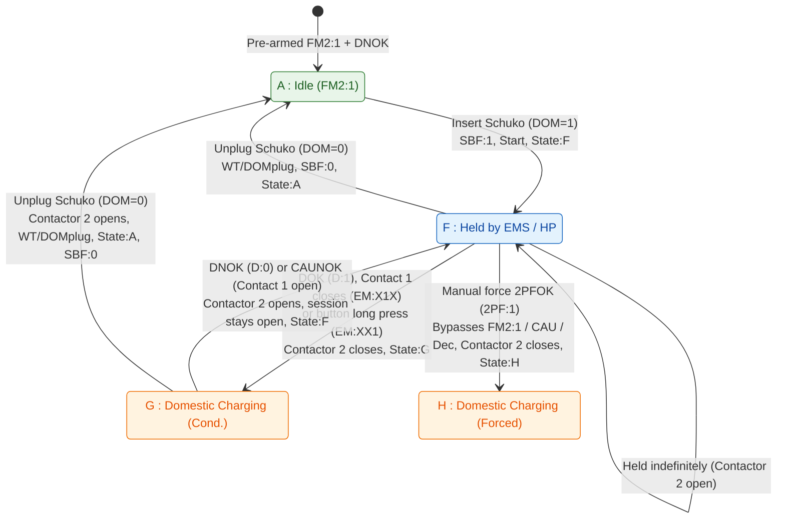

### 3.3 Domestic Local Stop (`SBNOK`) & Invalidation (`2PCNOK`)

Pressing the Stop button during a domestic charge drops Contactor 2, closes the `DOMplug` session, and parks in `State:P` as long as the plug remains inserted. Disabling the domestic socket via `2PCNOK` opens Contactor 2 and returns to `State:A`, ignoring `DOM` until `2PCOK`.

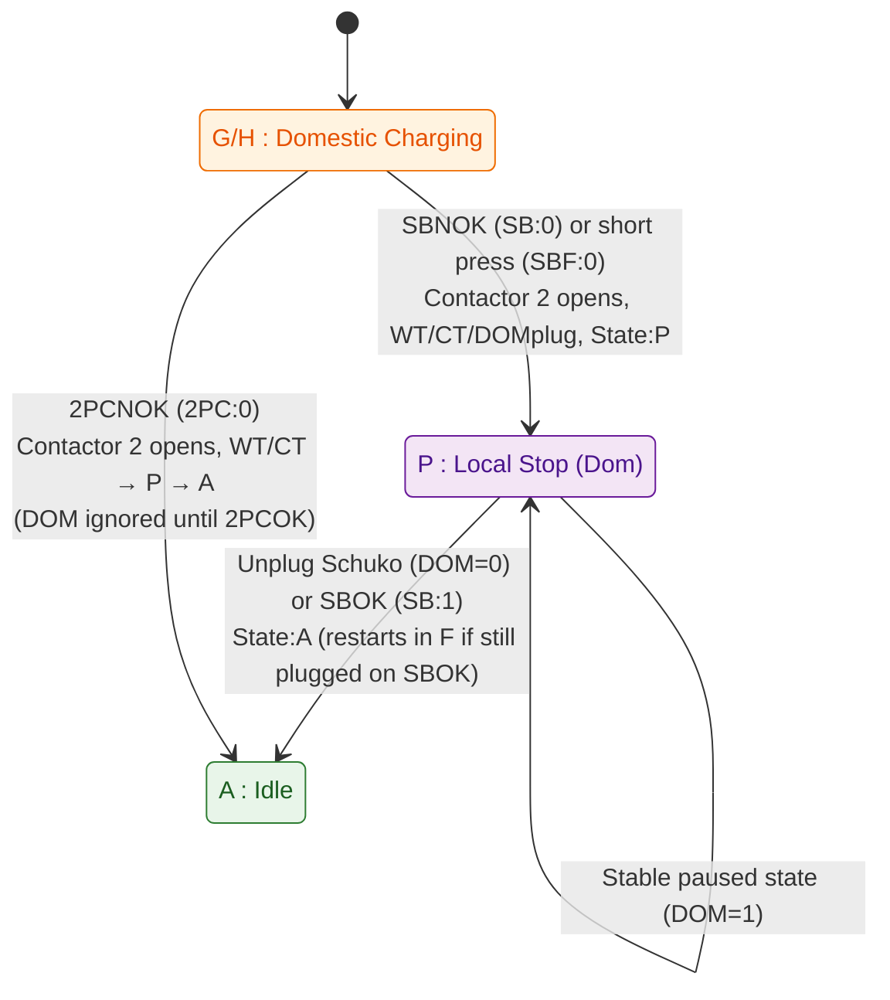

### 3.4 Absolute Type 2 Priority over Domestic Socket

Because the station shares internal feed constraints, plugging an EV into the Type 2 socket immediately preempts any active 2P+T domestic session (dropping Contactor 2). Once the EV finishes (`State:I`), the firmware automatically hands control back to the still-plugged domestic socket (`State:F` → `G/H`).

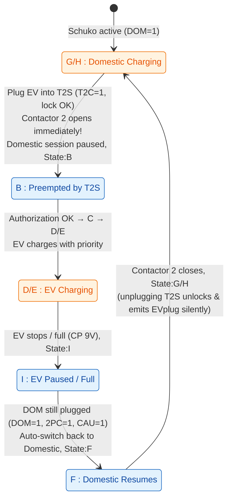

---

## 4. Three-Phase Modulation & TIC Linky Load-Shedding

### 4.1 Three-Phase Charge & Dynamic Current Modulation (11–22 kW)

On a three-phase board (`g_flag_02fd=0`), the effective setpoint is `min(CCS, CCCa, CCEl, CCCo, CCTIC)`. The firmware detects whether a three-phase or single-phase EV is drawing (`CPh:Tri` vs `CPh:Mono`, streaming `CCI:<I1>;<I2>;<I3>` at 1 Hz) and dynamically applies RAM-only `CC:xx` updates without writing EEPROM.

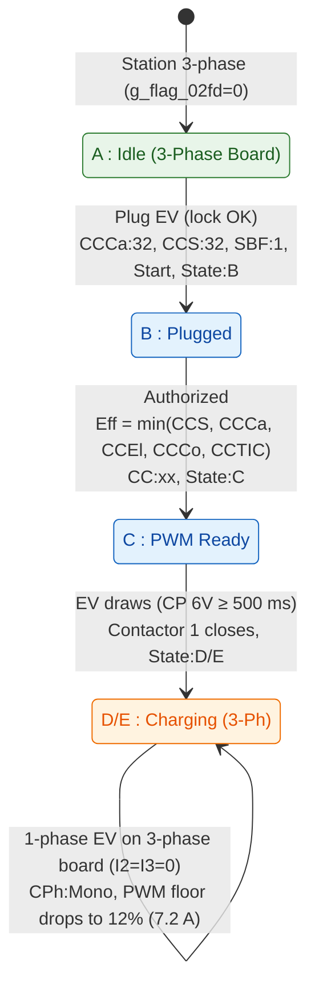

### 4.2 Hardware PWM Floor Trap → Overcurrent Reboot (`E:0010`)

> [!CAUTION]
> **Critical Three-Phase Limit:** Because the hardware clamps the three-phase PWM duty cycle at **22% (13.2 A)** while comparing measured phase current against `1.2 × CC`, sending `CC:11` (or lower) in three-phase causes `13.2 A ≥ 1.2 × 11 A` → `E:0010` after 8 seconds → forced watchdog reboot! Keep `CC ≥ 13 A` in three-phase (and `CC ≥ 7 A` in single-phase, where the hardware floor is 12% = 7.2 A).

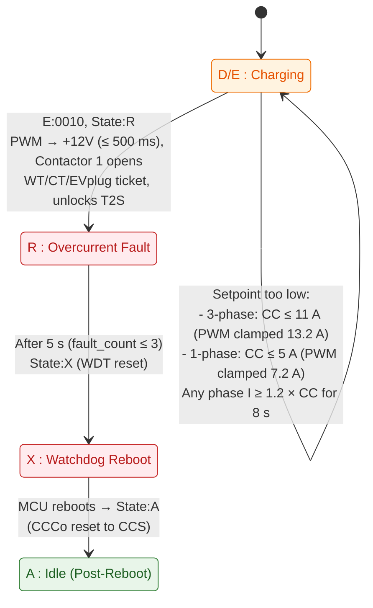

### 4.3 TIC Linky Off-Peak (`HP/HC`) & Autonomous Load-Shedding

When a Linky TIC meter is wired directly to the board, Peak Hours (`HP`) hold `CAU_t2s=0` in `State:B` (overridable by `DOK`), while dynamic overload (`≥ 125% Isub`) or insufficient `CCTIC` (< 8 A 1-ph / < 13 A 3-ph) triggers load-shedding with a **10-minute mandatory penalty** before resuming.

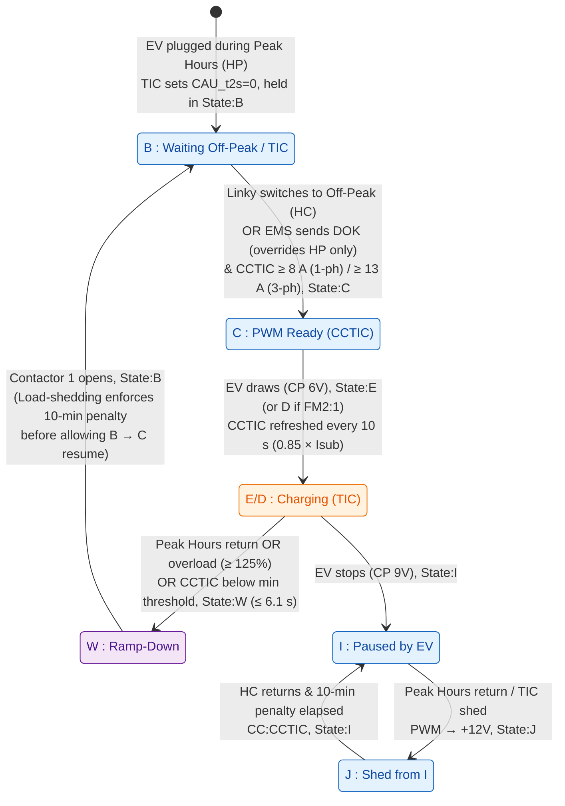

---

## 5. Hardware Faults, Safety Interlocks & Power Outage

### 5.1 Recoverable Faults (`State:R`) & Auto-Reboot (`State:X`)

Lock actuator failure (`E:0001`/`E:0002`), Contactor 1 failure to close (`E:0008`), or 8 s overcurrent (`E:0010`/`E:0011`) enter `State:R` and trigger a watchdog reset (`State:X` → `State:A`) after 5 s (latched after 4 consecutive faults). Missing EV diode (`E:0009`) clears as soon as the cable is unplugged without rebooting.

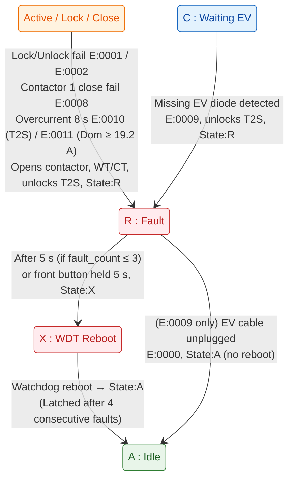

### 5.2 Critical Latched Faults (`State:S`) — Shunt-Trip MX

Welded/stuck Contactor 1 (`E:0007`) or 6 mA DC residual current / self-test failure (`E:0015`) immediately fires a 100 ms pulse on the external MX shunt-trip coil to trip the upstream circuit breaker and latches `State:S` until full power cycle.

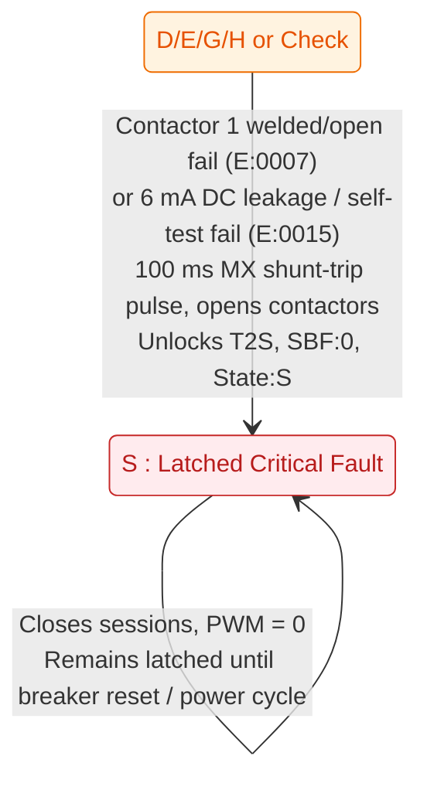

### 5.3 Control Pilot Short (`State:T`) & Ventilation (`State:N`)

- **CP Short (0 V):** Enters `State:T` (`E:0003`); clears back to `State:A` if unplugging the cable removes the short, or latches `State:S` (`E:0004`) if CP stays at 0 V with no cable plugged (internal board fault).
- **Ventilation (3 V / IEC State D):** Unsupported indoors — ramps down via `State:W`, holds PWM at +12 V in `State:N`, and returns to `State:B` (or `State:F`) once CP leaves 3 V.

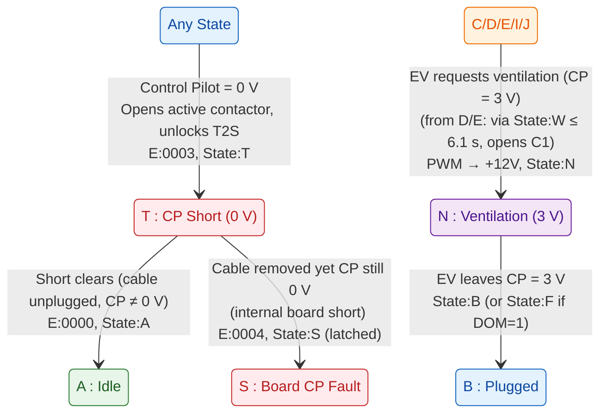

### 5.4 Mains Power Outage (`State:U` / `State:V` — `E:0012`)

After ≥ 400 ms loss of 230 V zero-crossing, the ATmega uses its capacitor reserve to emit `E:0012`, gracefully ramp down active sessions via `State:U` → `State:V`, unlock the T2S cable, log the `WT`/`CT` ticket, and perform a clean software reset once mains returns.

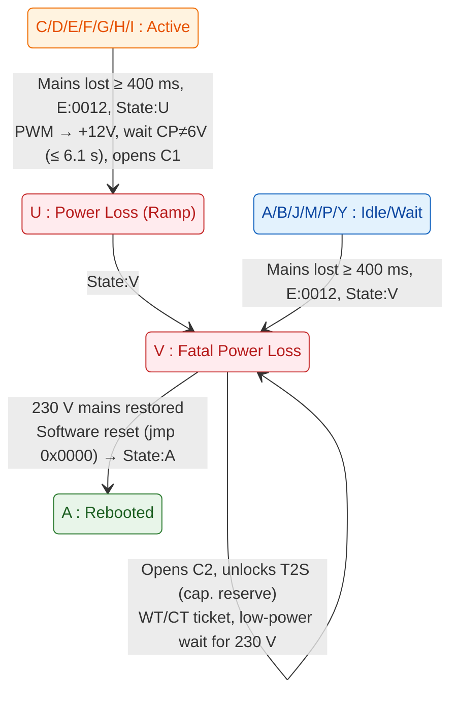
